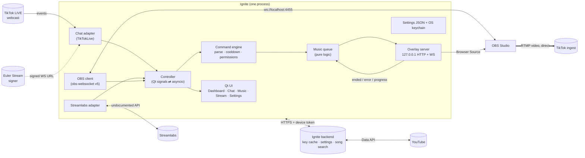

# Ignite: Research and Proposed Design

Status: **desktop app and server built** (2026-10-24). See §6 for what's been
verified and §7 for what's next.

Research date: 2026-10-24. Reference repos were read at their latest `main`
commits as of that date.

### Decisions (2026-10-24)

| Question | Answer |
|---|---|
| Stack | Python + PySide6 |
| Operating systems | Windows, macOS, Linux |
| Distribution | Private for now |
| Look | Current Ignite style, made cleaner, sleeker, more minimal |
| Backend | Yes: holds each user's stream key for 48h unless used first, plus anything else useful (see §5) |
| Music | Links **and** `!sr song - artist` search |
| Multistream | Out of scope: Ignite configures OBS; whatever OBS supports (plugins, multitrack) is up to OBS |

---

## 1. Summary of recommendations

| Decision | Recommendation |
|---|---|
| Stack | **Python 3.12+ / PySide6**, kept from the existing code. TikTokLive is Python, so chat runs in-process with no Node sidecar. |
| Stream keys | **Streamlabs route only**, as an isolated "experimental" adapter, with **manual RTMP entry** as the fallback that always works. |
| RTMP proxy | **None.** OBS streams directly to the URL and key that Streamlabs returns. |
| Chat | **TikTokLive**, imported as a library behind our own adapter, run **only on the user's machine**. |
| Music | **YouTube IFrame player** in a local overlay page that OBS loads as a Browser Source. No downloads, no yt-dlp, and the player stays visible. |
| OBS | Our own small **obs-websocket v5** client (or MIT-licensed `simpleobsws`). Do not use GPL `obsws-python`. |
| Backend | **Small aiohttp + SQLite service** for the 48h stream-key cache, settings sync, and shared song search. It never holds Streamlabs tokens and never runs TikTokLive (§5). |
| Storage | JSON settings in the platform config directory. Tokens, keys, and passwords go in the OS keychain (`keyring`). |

---

## 2. Reference research: what to take, what to leave

### 2.1 Loukious/StreamLabsTikTokStreamKeyGenerator: **primary reference for keys**

- License: **GPL-3.0**. We use it for behavior only and copy no code.
- How it works: it calls **undocumented** Streamlabs Desktop routes under
  `streamlabs.com/api/v5/slobs/...` with a bearer token and a
  Streamlabs Desktop User-Agent:
  - `GET  /tiktok/info?category=` returns eligibility, the user, and a category search
  - `POST /tiktok/stream/start` (multipart: title, device_platform, category,
    audience_type) returns `{id, rtmp, key}`
  - `POST /tiktok/stream/{id}/end` returns `{success}`
  - Token: PKCE browser login to `/slobs/login`, a localhost callback, then
    `/api/v5/slobs/auth/data`
- No official Streamlabs developer API for TikTok keys was found. The public
  Streamlabs API covers alerts, donations, and the socket API, not TikTok ingest.
- **Worth reproducing:**
  - **Eligibility check.** `/info` returns `can_be_live`, `application_status`, and
    `user.username`. Show these and block "Generate" when the account can't go
    live. *(The current code does not do this yet.)*
  - Category search, title, audience/mature flag
  - Start, end session, and copy URL/key
  - Token persistence between launches *(also missing today)*
  - Optional: read the token from a local Streamlabs Desktop install
    (`slobs-client/Local Storage/leveldb`). This works on **Windows and macOS only**.
  - "Open TikTok LIVE Center monitor" link
- **Skip:** the updater, donation prompts, and the plaintext token config file.

The existing `src/stream_credentials.py` is an independent implementation
of these routes with injectable transport, safe errors, and tests. Keep it as
the Streamlabs adapter.

### 2.2 Loukious/TikTokStreamKeyGenerator: **mostly do not adopt**

- License: **none found.** Under copyright law that means all rights reserved,
  so treat it as reading material only.
- Its own README says the Streamlabs project "is still the preferred option".
- Architecture: it creates a LIVE room by **impersonating TikTok LIVE Studio**
  (signed requests via a **paid RapidAPI signer**), runs a **local FFmpeg RTMP
  proxy**, and **injects signed SEI metadata** into the video. It says direct OBS
  connections with those keys get closed or flagged for "integrity/authenticity".
- That goes directly against the "direct OBS to TikTok, no relay" goal and adds
  a paid third-party dependency, FFmpeg, and the highest account-flagging risk.
- **Ideas worth keeping, implemented our own way:**
  - Showing the **share URL** of the live room, if Streamlabs returns one
  - Chat reader **with automatic reconnect** (we get this via TikTokLive)
  - **Dual layout (portrait + landscape):** account-gated, unverified even
    upstream. Out of scope.

### 2.3 isaackogan/TikTokLive: **chat engine**

- v7.0.1, Python ≥3.10, asyncio. License is **"Modified AGPL-3.0"**:
  - §18 lets you *import it into downstream apps and bots without your app
    becoming AGPL*, "provided they do not trigger Section 19".
  - §19: the exception is **revoked** if it powers a hosted service, WebSocket
    relay, or SaaS for third parties. Running it on our backend would trigger this.
  - Therefore: **TikTokLive runs on the user's desktop only, never on a server.**
- It is read-only. It connects by `@unique_id` with no login and emits Comment,
  Gift, Like, Follow, Share, Join, viewer count (RoomUserSeq), LiveEnd, Connect,
  and Disconnect events.
- **External dependency:** each connection needs a signed WebSocket URL from
  the **Euler Stream** signing service (`api.eulerstream.com`). There are free
  community rate limits, and an API key raises them. Upstream says plainly that
  it is "not a production-ready API" and is a reverse-engineering project.
- Error types we must map to UI states: `UserOfflineError`,
  `UserNotFoundError`, `AgeRestrictedError`, `WebcastBlockedError`,
  `SignatureRateLimitError` (exposes `RateLimit-Reset`), `SignAPIError`.
- It has **no built-in reconnect loop**, so we write it with backoff.
- It **cannot send chat messages.** MusicBot replies in chat ("@user added X").
  We give that feedback through the overlay instead.

### 2.4 zerodytrash/TikTok-Live-Connector: **not needed**

- Node/TypeScript, v2.5.0, the same modified-AGPL terms (§18–21), and the same
  Euler signing dependency. It only makes sense with an Electron/Node stack.
  With Python it would add a sidecar process for no gain.

### 2.5 overabstractor/MusicBot: **reference for music UX**

- License: **none found.** Reading material only.
- Stack: .NET 9 + WPF + React + SQLite + SignalR + NAudio, **Windows-only**,
  **downloads audio with yt-dlp**. We reproduce neither the stack nor the
  playback method.
- **Feature ideas worth reproducing:**
  - Commands: `!sr`/`!play`, `!skip`, `!queue`, `!song`, `!pos`, `!revoke`
    (remove my request), `!history`, `!bump` (mod)
  - Queue rules: max queue size, max songs per user, banned-song list,
    vote-skip
  - "Presence check": warn the requester before their song and skip it if they
    are gone. Nice to have later; it needs chat output we don't have, so it would
    use the overlay.
  - Overlays: **player**, **now playing**, **queue**, each in a horizontal and a
    **vertical** variant (TikTok is portrait, which matters a lot here), plus
    toasts.
- **Skip:** Spotify, Twitch, Kick, the OAuth relay worker, downloads, the library
  cache, and loudness normalization (not possible with an embedded player anyway).

---

## 3. Architecture



### Runtime model

- **Two threads.** The Qt GUI thread, plus one background thread running an
  asyncio loop for chat, OBS, and the overlay server. A small bridge moves
  results across as Qt signals.
- **Each integration is an adapter** with the same shape: `connect()`,
  `disconnect()`, a `state` (`offline · connecting · connected · degraded ·
  error(message)`), and typed events. The dashboard shows every adapter's
  status the same way, which is what makes it feel like one product.
- **Third-party libraries are imported in exactly one module each.** If
  TikTokLive or Streamlabs breaks, only that file changes.

### Layout

```
src/ignite_live/
  app.py                 entry point (ignite)
  controller.py          owns every integration; the UI only talks to this
  actions/
    rules.py             event → action rules: data model, validation, JSON form
    engine.py            matches events to rules; cooldowns, like totals, milestones
    goals.py             goal bars: data model and GoalTracker (progress, stop/repeat/raise)
  games/
    base.py              shared settings helpers, GameEnded, the Game base class
    tug.py, boss.py, poll.py   the three games (pure logic)
    manager.py           one game at a time; Settings.games validation
  viewers/
    store.py             viewers.sqlite3: points and all-time totals, batched writes
    points.py            earning and spending rules (Settings.points)
    leaderboard.py       stream and all-time boards, first-place changes
  moderation/
    filter.py            blocked words (whole words, dodges, wildcards), links, blocked viewers
  setup/
    hardware.py          CPU threads, RAM, graphics cards (no extra dependencies)
    tuning.py            PC tier + upload speed → recommended OBS output settings
  live/
    checklist.py         pre-stream checklist: Preflight snapshot → checks with fix ids
    analytics.py         StreamRecorder (per-minute buckets) and the stream report
  core/
    events.py            ChatComment, ChatGift, ChatFollow, ChatLike, ChatShare, ViewerCount, ConnectionState
    http.py              injectable blocking HTTP transport
    keychain.py          OS keychain wrapper for tokens, keys, passwords
    key_cache.py         48h stream-key cache on this device (when no server)
    runtime.py           asyncio thread + Qt bridge
    settings.py          JSON settings (non-secret), synced subset
    profiles.py          .igniteprofile export/import (zip: profile.json + sounds/)
  integrations/
    streamlabs.py        undocumented Streamlabs routes + PKCE login + eligibility
    tiktok_chat.py       the only module that imports TikTokLive; reconnect/backoff
    obs.py               obs-websocket v5 client
    backend.py           desktop client for the Ignite server
  music/
    commands.py          !sr/!play, !skip, !revoke, !song, !queue; roles, cooldowns
    queue.py             size/per-user/duration limits, dedupe, bans, skip rules
    youtube.py           link parsing, "song - artist" parsing, Data API search, oEmbed
    session.py           glues chat → commands → lookup → queue → overlay
  overlay/
    server.py            aiohttp: token-guarded pages + WebSocket
    static/nowplaying.html  now-playing card that plays the music (visible YouTube player as the cover)
  server/                backend: app.py (API), store.py (SQLite + Fernet), CLI
  ui/
    theme.py             design tokens + stylesheet
    widgets.py           Card, Page, field, row, status dot
    main_window.py       nav rail, live status list, notice bar
    flow_layout.py       button rows that wrap in a narrow window
    pages/               dashboard, stream, chat, music, settings
Dockerfile, deploy/      server image; compose with Caddy for HTTPS
packaging/               PyInstaller spec, build script, Inno Setup installer, icon
tests/                   all network faked; one headless smoke test of the window
```

### Data flow for one song request

1. A TikTok comment `!play https://youtu.be/dQw4w9WgXcQ` reaches the chat adapter,
   which emits `ChatMessage`.
2. The command engine checks the prefix, the per-user cooldown, the global
   cooldown, and the role (follower/mod/anyone, configurable).
3. `youtube.py` extracts and validates the 11-character video ID
   (`[A-Za-z0-9_-]{11}`), then fetches the title and author via the keyless oEmbed
   endpoint.
4. The queue enforces max length, max songs per user, the banned list, and
   duplicates. It emits `QueueChanged`.
5. The overlay server pushes the queue over WebSocket. `nowplaying.html` plays it with
   the IFrame API and reports `ended`, `error(code)`, and progress back. With
   several Now Playing copies open, the server picks one (the oldest) to play; the
   others show the cover and follow its progress. `/overlay/player`, the old
   player page, now serves Now Playing so existing OBS sources keep working.
6. If the player reports error 101/150 (embedding disabled), the song is
   auto-skipped and a toast says "@user: that video can't be embedded".

### OBS integration (obs-websocket v5, built into OBS 28+)

- `Identify` with SHA-256 challenge auth (password from the keychain).
- `SetStreamServiceSettings` → `rtmp_custom` with `{server, key}`, read
  back with `GetStreamServiceSettings`, and monitored with `GetStreamStatus`
  plus `StreamStateChanged` events. Optional "Start streaming" button
  (`StartStream`).
- Refuse to change the destination while OBS is live.
- Optional: "Add overlay to current scene" via `CreateInput`
  (`browser_source`, with `reroute_audio` on so audio shows up in the OBS mixer).

### Event → action rules (Actions tab)

Rules live in `Settings.action_rules` as JSON. They sync through the backend
like other preferences and are capped at 100 rules × 8 actions, well under the
64 KB sync limit. `actions/rules.py` drops anything malformed, the same way
`Settings.apply` treats bad values.

```json
{"id": "r1", "name": "Rose → confetti", "enabled": true,
 "trigger": {"kind": "gift", "gifts": ["Rose"], "min_coins": 0, "role": "everyone",
             "platforms": ["tiktok", "twitch", "youtube"]},
 "actions": [{"kind": "alert", "text": "{user} sent {count}× {gift}!"},
             {"kind": "sound", "target": "confetti.mp3", "volume": 80},
             {"kind": "source", "target": "Confetti", "scene": "", "mode": "show", "seconds": 5}],
 "cooldown_s": 0, "user_cooldown_s": 10}
```

- **Triggers:** `gift` (names, minimum diamonds × count), `follow`, `like`
  (`every` N likes this stream, summed across TikTok's batches; one firing per
  batch), `share`, `command` (no built-in command names), and `viewers`
  (milestone `every`, once per stream).
- **Actions:** `alert` and `sound` are sent to the Alerts overlay. A sound in a
  rule that also has an alert plays when that alert shows. Sound files come
  from `<config dir>/sounds` and are served by name only at
  `/sounds/{name}?token=…`. `tts` passes through the TTS link and blocked-word
  rules and needs text to speech turned on. `scene` and `source` can undo
  themselves after `seconds`. `song` calls `MusicSession.request`, which skips
  the command cooldown but keeps every queue rule.
- **Threading:** `ActionEngine.match` runs on the loop thread in
  `Controller._on_chat_event`. Speech crosses to the GUI thread through the
  `action_speech` signal. A failing action (e.g. OBS closed) is reported once a
  minute per rule and doesn't stop the rule's other actions.
- **Likes and shares** reach only the rules, never the chat feed, chat overlay,
  or Discord: likes arrive several times a second.
- **"This stream"** begins when OBS starts streaming. Like totals and milestones
  reset then. They also reset if OBS's websocket reconnects mid-stream, a known
  limitation.

### Pre-stream checklist

`Controller._preflight` gathers a `Preflight` snapshot on the loop thread:
- what the app already knows: statuses, studio, key, rules
- OBS's stream destination (main output only; the plugin outputs can't report
  their key back)
- the browser sources whose URL is our player page, with their
  `reroute_audio` setting
- the replay buffer length (`GetProfileParameter` `RecRBTime` under
  `SimpleOutput` or `AdvOut`)
- which overlays are open: each page sends `&page=` when it connects, and
  previews don't count

`live/checklist.evaluate` is pure and returns checks (`ok`, `info`, `warn`,
`fail`), each with an optional fix id that `ui/checklist.run_fix` carries out.
Start Streaming runs the checklist first. A failure asks "Go live anyway?";
warnings only add a notice.

"Key valid" means present, unexpired, and matching OBS. Nothing short of
streaming proves TikTok will accept it.

The clip check applies only when a rule saves clips, not for `!clip` alone,
which is on by default.

### Auto-clipping

The `clip` action waits `seconds` (default 10, max 60) so the clip includes the
reaction. It runs as its own task, so it doesn't hold up the rule's other
actions. `Controller._save_clip` picks the buffer:
- the Vertical Canvas backtrack when TikTok streams from that canvas, or when
  it's the only buffer running
- otherwise OBS's replay buffer
- with neither running it raises `ObsError`, which becomes a once-a-minute
  notice; `!clip` shows its toast instead

The clip moment is logged before saving, because OBS's `ReplayBufferSaved`
event (with the file path) can arrive before the request returns.

The `spike` trigger counts comments, gifts and like batches in the last 10 s
against the stream's usual rate per 10 s (excluding that window). It waits
2 minutes into the stream before firing, and then at most every 30 s whatever
the rule's own cooldown. **Add Auto-Clip Rules** just creates two ordinary
rules.

### Stream reports

`StreamRecorder` starts when OBS starts streaming and finishes when it stops.
It's fed from `_on_chat_event`, the queue (songs), OBS events (scene changes,
saved clips) and goals.

What it keeps:
- per-minute `viewers` (summed across platforms, carried forward between
  counts), comments, likes, gifts, coins, follows, shares, and the song playing
- songs with their own totals
- moments: clips, goals, gifts of 500+ coins, scene changes
- the top 20 gifters and chatters

There are no chat logs. Reports are saved to `<config>/streams/<start>.json`
every 30 s and at the end, and kept until deleted (about 15 KB per 3 hours).

The report finds:
- drops of at least 3 viewers and 15 % within 3 minutes; on ties, the tighter
  window wins
- each song's engagement: its chat and likes per minute against the stream's
  average (1.0 = usual), skipping songs that played under 30 s

The CSV export puts a `'` in front of song titles that start with `= + - @`,
so a title can't run as a spreadsheet formula.

If OBS's websocket drops mid-stream, the report closes there, and a new one
starts if OBS is still live on reconnect.

### Setup guide and OBS tuning

`ui/setup_guide.py` opens on first launch (no TikTok username and
`setup_done` unset) and from Help. Its steps are Welcome, Your PC, Connect
OBS, Tune OBS, TikTok, Overlays, Extras and Done; every one can be skipped.

**Detection** (`setup/hardware.py`):
- **CPU threads:** `os.cpu_count()`.
- **RAM:** `/proc/meminfo` on Linux, `GlobalMemoryStatusEx` on Windows, and
  `sysctl hw.memsize` on macOS.
- **Graphics cards:** `/sys/class/drm/*/device/vendor` and `lspci` on Linux,
  PowerShell `Win32_VideoController` on Windows (no console window), and
  `system_profiler` on macOS (Apple silicon counts as Apple).
- Anything unreadable stays unknown, and unknown means a careful tier.

**Tiers:**
- **Strong:** a GPU encoder, at least 8 threads and at least 16 GB.
- **Light:** no GPU encoder and at most 4 threads or 8 GB.
- **Balanced:** everything else.

**Recommendations** (`setup/tuning.py`):
- **Bitrate:** 2,500 / 4,000 / 6,000 kbps, capped at 75 % of the upload speed
  the user picks (floor 2,000). An unknown upload speed gives 2,500.
- **Resolution:** 1080p drops to 720p below 3,500 kbps.
- **Frame rate:** 60 FPS needs 4,500 kbps or more.
- **Encoder:** the best GPU encoder found, in the order NVENC, AMF, Apple
  VideoToolbox, QuickSync; otherwise x264 *veryfast*.
- **Overlays:** each tier gets a different set of suggested overlays.

**How it changes OBS:**
- Only the scaled **output** size (`SetVideoSettings`, never the base canvas,
  which would rearrange scenes) and the frame rate.
- Encoder, bitrate and preset only in Simple output mode
  (`SetProfileParameter` `SimpleOutput StreamEncoder/VBitrate/Preset`). In
  Advanced mode, or when TikTok streams from the Aitum Vertical Canvas, those
  rows are marked "by hand".
- Nothing changes while streaming or recording.

**Backup and undo:** the settings from before the first tuning are kept in
`tuning_backup` (this computer only) for **Undo Tuning**. After applying, the
guide reads OBS back and reports anything OBS didn't keep, such as an encoder
this build doesn't have.

The Simple-mode encoder ids (`x264`, `nvenc`, `amd`, `qsv`, `apple_h264`)
still need checking against real OBS builds.

### Moderation

Chat on TikTok, Twitch and YouTube is read-only here, so moderation covers what
Ignite itself says, shows and plays.

**Blocked words** (`Settings.blocked_words`) replace the old TTS-only
`tts_blocked_words`; `Settings.apply` migrates the old key. How they match:
- whole words, ignoring case and accents (NFKD, so fullwidth letters count too)
- dodges: separators between letters (`b.a.d`, `b a d`), repeated letters,
  and look-alike characters (`4@` for a, `3` for e, `1!|` for i/l, `0` for o,
  `5$` for s…)
- `*` at the end matches the rest of a word
- the old substring check blocked "class" for "ass"; whole words don't

Each place is switchable (`mod_filter_*`):
- **TTS:** the message isn't read; a blocked name is read as "someone".
- **Chat overlay, alerts and Discord:** the word becomes `***`, or with
  `mod_chat_mode = "hide"` the message is left out.
- **Songs:** refused before searching, and again on the found title and
  channel.
- **Rule alerts:** viewer-supplied values (`user`, `args`, `message`, `mvp`)
  are masked.

**Links:** `mod_hide_links` turns links (including bare `site.com` and
`site dot com`) into `[link]` on stream and in Discord. TTS keeps its own
"say link" option.

**Blocked viewers** (`platform:id` from the Viewers tab or `!block`, or a
plain name for any platform): their comments only reach the streamer's own
chat panel. Their gifts still count.

**Song safety** (queue rules), each refusal carrying its template key on
`QueueRejected.key`:
- **Unknown length:** links now get their length from the watch page
  (`lengthSeconds`; undocumented, so `None` on failure). The desktop also looks
  it up when an older server leaves it out. With `refuse_unknown_length`,
  songs whose length still isn't known are refused.
- **Explicit:** a title heuristic, since YouTube has no flag. With
  `refuse_explicit`, search skips explicit titles and prefers "clean" or
  "radio edit" versions.
- **Auto-ban:** refusals for being too long, explicit, or a blocked word add
  the video to the ban list with a reason (`banned_reasons`, shown as
  `id  # reason` in Preferences). Unknown length and a full queue never ban.

### Panic button

The toolbar or Ctrl+Shift+P (while focused) runs it, and so does `!panic` from
a mod when that's allowed. A system-wide hotkey is planned through P6's local
API. `Controller.panic` records what it actually changed, and `resume` undoes
only that:
- **TTS:** muted, unless it already was.
- **Alerts:** the Alerts overlay drops what's showing and waiting, and ignores
  new ones (`quiet` in the overlay state).
- **Music:** the player pauses (`paused` in the overlay state; a new song is
  cued, not played).
- **Rules:** action rules are skipped (`rules_paused`) and the running game is
  stopped.
- **Scene:** switches to `panic_scene`. Resume switches back only if the BRB
  scene is still showing.
- **Mic and other inputs:** `panic_mute_inputs` that were unmuted get muted,
  and only those are unmuted again.

Both panic and resume are stream-report moments.

### Simulated events and test buttons

`Controller.simulate` runs fake events through `_on_chat_event` with
`simulating` set. Rules, goals, games, overlays, TTS and song requests react
to them. The stream report, points and leaderboards check the flag and ignore
them. Chat commands run later as tasks, after the flag is cleared, so
simulated viewers' keys are also remembered in `_simulated_users`: they never
pay or earn points.

The test buttons:
- **Send Test** on the Alerts and Chat overlays simulates sample events.
- **Goals:** the test pushes a fake "reached" snapshot and runs the "Goal
  reached" rules, then restores the real progress.
- **Leaderboard:** the test shows sample boards and a callout.
- **Games:** the test runs the game for 30 s with simulated players.

### Viewers and loyalty points

`viewers.sqlite3` (Python's own `sqlite3`) has one row per `platform:id`:
name, points, active minutes, messages, coins, likes, first and last seen.
Changes collect in memory and are written every 10 s and on exit. Balances
include unwritten changes, and a balance never goes below 0. The file is local
only: never synced, never in profiles.

Stats are always counted, because the leaderboards need them. Points are only
awarded and spent while `Settings.points["enabled"]` is on. Earning:
- **Being around:** points every 5 minutes for viewers who commented, liked or
  gifted in the last 10 minutes, while live. TikTok doesn't list silent
  viewers, so "active" is the honest proxy.
- **Chatting:** per message, at most every 30 s.
- **Gifts:** per coin.
- **Follow and share bonuses:** once per stream.

Costs apply to chat requests (refunded if the lookup or the queue rejects
them) and to `!bump`, `!say` and `!sound`, where each sound can have its own
price. Rule-triggered requests are free. `!points` and `!give` (mods) work
too, and every points command is only active while points are on. The
streamer and simulated viewers never pay.

### Leaderboards

Each stream has boards for gifters (coins), likers and chatters, counted as
events arrive. The all-time versions, plus most points, are read from the
store after each flush.

A new #1 means a different viewer at the top; ties keep the current leader.
It does three things:
- sends a `leader` message to the overlays
- runs "New #1" rules (which can filter by board)
- adds a stream-report moment, for the gifter boards only

The first all-time read at start-up isn't announced. Overlays get board
updates at most every 1.5 s.

### Viewer games

`GameManager` runs one game at a time, using the settings in
`Settings.games` (synced, part of profiles). It's fed every event, simulated
ones included, and ticked once a second for timers. Overlays get updates at
most 4 times a second.
- **Tug-of-war:** two modes. In gifts mode each team has its own gifts. In
  join mode viewers type `!join <team>` and any gift (or likes, if
  `like_value` is set) pulls for their team. Gifts pull by coin value. The
  first team to lead by `target` wins; when the timer runs out, the leader
  wins.
- **Boss fight:** likes, gifts (per coin) and, optionally, comments deal
  damage. A defeated boss gives a non-final `GameEnded` (winner "Chat") and
  comes back with `growth` % more HP. Stopping the game means the boss got
  away. The picture is a file from `<config>/images`, served at
  `/images/{name}` like sounds, or a TikTok image link.
- **Chat poll:** viewers vote with `1`, `!vote 1`, or the option's text. One
  vote each, and a later vote replaces it. Ties are reported as ties.

Every `GameEnded` goes to the overlay (`game_over`), to "Game ended" rules
(`{winner}`, `{mvp}`), and to the stream report: each game is a window like a
song, with its engagement compared to the rest of the stream. Rules can start
or stop games with the "Start or stop a game" action.

### Goals

`Settings.goals` (synced, max 20) defines bars of the kinds `likes`, `coins`
(diamonds × count), `follows`, `shares`, and `gift` (one named gift).
`when_done` is `stop`, `repeat` (carries the overflow), or `raise` (by
`step`, or by the original target). `GoalTracker` counts on the loop thread
next to the action engine. Each event gives at most one `GoalReached`, which
goes back through the engine, so "Goal reached" rules can celebrate. Progress
is local, not synced. It's saved to `<config>/goal_progress.json` at most
every 5 s and on exit, and resets when OBS starts streaming unless the goal
has `keep`. Changing a goal's target applies straight away; changing what it
counts starts it over. The overlay gets a separate `goals` message, which is
replayed to pages that open later.

### Profiles

A `.igniteprofile` file is a zip with `profile.json`
(`{"format": "ignite-profile", "version": 1, "name", "created",
"settings"}`) and `sounds/<name>` for each sound file the rules use.

- **Included:** only `PROFILE_FIELDS`: rules, goals, texts, commands, the
  `!clip`/`!scene` switches, overlay style, volume, song-request rules, and TTS
  behaviour and voice.
- **Never included:** usernames and channels, OBS, backend and overlay
  addresses and token, window state, whether TTS is on, system voices (they
  differ per machine), or anything from the keychain.

Imports are untrusted:
- Size caps are checked before reading: 30 MB per file, 5 MB per sound, 1 MB
  for `profile.json`.
- Only `sounds/<SOUND_NAME>` entries are extracted. Anything else is listed as
  ignored.
- Values go through `Settings.apply`, and values it rejects aren't carried
  over.
- Newer format versions are refused with "update the app".
- The preview lists what changes and warns about custom CSS that loads from
  the internet (it reveals the streamer's IP address).

"Add" mode keeps the current rules and goals. A clashing goal gets a new id,
and the imported rules that point at it follow it. Existing sound files are
kept unless the user ticks "replace". Saved profiles live in
`<config>/profiles/`.

### Aitum plugins (choosing the TikTok output)

`integrations/obs_targets.py` lists every output that can carry the stream and
sends the key to the chosen one only:

| Output | Set server/key | Start/stop just that output |
|---|---|---|
| OBS main stream | `SetStreamServiceSettings` | `StartStream` / `StopStream` |
| Vertical Canvas output | vendor `aitum-vertical-canvas` `update_stream_server` / `update_stream_key` (by index) | Multistream `start_output` by name; without Multistream, Vertical Canvas `start_streaming` starts every enabled vertical output |
| Multistream output | not possible: the plugin has no request for it | Multistream `start_output` / `stop_output` |

Names and order come from Multistream's `get_outputs`; with only Vertical
Canvas installed, names are read from its saved `plugin_config/vertical-canvas/config.json`.
Plugin outputs send no events, so their live state is polled every 5 s.

### Design system

The app comes in **dark**, **light**, four seasons (**spring**, **summer**,
**autumn**, **winter**) and three holidays (**halloween**, **thanksgiving**,
**christmas**) (`ui/theme.py`: named palettes, one stylesheet built from any of
them, on Fusion). The seasonal and holiday modes are dark palettes that keep the
same rules (one accent, red only for live and danger); a test checks every
mode's text contrast. **Seasonal** (`core/seasons.py`) picks one by the date,
for the app and the overlays alike, and the app re-checks twice an hour.
Dark: window `#0E1015`, panels `#161920`, inputs `#1E222B`, dividers `#262B36`;
text `#E8EAF0` / `#8B92A5`. Light: window `#E9ECF1`, white panels, inputs
`#F0F2F5`, dividers `#DCE0E7`; text `#161A22` / `#5E6577`. Both: one
ember-orange accent (`#FF7A3D`) for the main action, selection and progress;
red for live and danger, green healthy, yellow warning (darker shades in light
mode, so they read on white). Colour only where it means something:
docks are separated by background, not boxes; tabs are flat with an orange
underline; only Start Streaming and Panic are filled. Buttons take `primary` /
`live` / `danger` Qt properties. Code that paints its own colours reads
`colors()` and listens to `theme_changed()`. The overlays
keep their own 21 themes (`overlay/static/themes.css`), seasons and holidays included, chosen
separately from the app mode.

**Updates** (`core/updates.py`, `ui/updates.py`): the app reads GitHub's
latest release for `sh1ftycode/IgniteLive`, downloads the file for how it was
installed (the setup for an Inno Setup install, the AppImage for an AppImage),
verifies it against the release's `SHA256SUMS.txt` (made by the release job),
and installs it on quit or from the banner: the setup runs with `/VERYSILENT`
(and `/RELAUNCH=1` to start Ignite again, see `installer.iss`); the AppImage is
swapped in place. The checksum catches broken or swapped downloads, not a
compromised repository; signing the builds would.

- Navigation: a left rail with **Dashboard · Chat · Music · Stream · Settings**.
- A persistent status strip shows four pills (TikTok chat, Streamlabs, OBS,
  Overlay), each with the shared state colors.
- Errors appear inline in the panel they belong to, with modals only for
  destructive confirmations. Today every error is a `QMessageBox`.

---

## 4. Risks

### 4.1 API access and stability

| Risk | Likelihood | Mitigation |
|---|---|---|
| Streamlabs changes or blocks the undocumented `/slobs/tiktok/*` routes | **High over time** | Isolated adapter labeled "experimental"; manual RTMP entry always available; contract tests on response shape. |
| Streamlabs flags the account for using a spoofed Streamlabs Desktop User-Agent | Medium | Disclose this in the UI. One request per user action, no polling. |
| The account lacks Streamlabs TikTok LIVE access (application approval) | Common | Show `application_status`/`can_be_live` before Generate. |
| Euler signer rate limits or downtime break chat | Medium | Exponential backoff that respects `RateLimit-Reset`; an optional user-supplied Euler key; chat is "degraded" and never blocks streaming or music. |
| TikTok changes its webcast protocol | Medium | Pin the TikTokLive version; upgrade deliberately. |
| Euler Stream sees which usernames you connect to | Certain | Disclose in Settings. |
| Twitch changes anonymous IRC reading (`justinfan` login) | Low | It's Twitch's documented, long-standing read-only mode; the client reconnects with backoff and reports a clear error for unknown channels. |
| YouTube changes its web chat endpoints (`/live_chat` page, `youtubei/v1/live_chat/get_live_chat`) | Medium | Isolated adapter (`integrations/youtube_chat.py`); failures become "retrying" statuses, never crashes. The official Data API is the fallback, but its chat polling costs quota on every request, so it isn't the default. |
| Microsoft changes Edge's voice service (used through the `edge-tts` library) | Medium | Kept as a pinned dependency to upgrade; failures skip that message and show a "degraded" status, never block chat. The offline system voices remain as a fallback choice. `edge-tts` is LGPL, so the build ships it as replaceable `.py` files. |
| TikTok blocks its in-app TTS endpoint or the streamer's session expires | Medium | Optional voice; clear errors ("paste a fresh session ID"). The session ID is a login credential: stored only in the keychain, only sent to TikTok, never logged or shown in errors. |
| No speech engine on the computer (Linux without speech-dispatcher) | Common on Linux | Text to speech is off by default; when turned on without voices it shows an error with the install command. Windows (SAPI/WinRT) and macOS have voices built in. |

### 4.2 YouTube and music

- **The player must stay visible.** YouTube's policies require embedded
  players to be at least **200×200 px**, **not covered by overlays**, and not
  played from a **background player** (Developer Policies III.I.9). They
  also forbid separating the audio from the video (III.I.7). A hidden,
  audio-only player in OBS would break these rules. So the Now Playing overlay
  shows the video at ≥200×200 with nothing on top, with the song details
  *beside* it, not over it. Searches use YouTube Music's song catalog, whose
  official audio tracks show just the album cover, so the player reads as
  cover art.
- **Copyright is not solvable in software.** Playing commercial music on a
  TikTok LIVE can get the stream muted or restricted no matter how it is
  played. Mitigations: an allowlist or "my playlist only" mode, a banned list,
  and a clear notice in the Music page.
- Some videos can't be embedded or are age-restricted. These are auto-skipped
  with feedback.
- Search by song name works with no key: without a Data API key, the app
  calls the search endpoint youtube.com's own pages use (`youtubei/v1/search`,
  no key, no quota) and confirms each pick with oEmbed, which refuses videos
  that can't be embedded. It's undocumented and may change or be blocked, so it
  is the default only because asking every streamer for a Google Cloud key is
  too much setup. With a key (or the backend), search uses the official
  `search.list` (100 of 10,000 daily units, so about 100 searches/day per key);
  the backend caches results for 24h and caps each user at 80 searches/day.
  Links cost no quota (keyless oEmbed).
- Spotify playback (requests played in the streamer's Spotify app) was built
  and then removed (2026-10-26; it's in commit `b5ac18a`). Spotify limits a
  development-mode app to five allowlisted users, and the extended quota that
  TikFinity-style "log in with Spotify" needs is only granted to established
  businesses. The background playlist stays: it only reads a public playlist's
  song names and plays them from YouTube.
- No downloading, caching, or yt-dlp, per YouTube Developer Policies III.E.1.

### 4.3 Licensing

| Component | License | How we use it |
|---|---|---|
| StreamLabsTikTokStreamKeyGenerator | GPL-3.0 | Behavior reference only, no code copied. |
| TikTokStreamKeyGenerator | None (all rights reserved) | Reading only. |
| MusicBot | None (all rights reserved) | Feature ideas only. |
| TikTokLive | Modified AGPL-3.0 (§18 exception) | Imported in the desktop app; **never hosted**. |
| TikTok-Live-Connector | Modified AGPL-3.0 | Not used. |
| PySide6 | LGPL-3.0 | Keep the Qt libraries dynamically linked in builds (PyInstaller's default). |
| obsws-python | GPL-3.0 | **Avoid**: use our own client or `simpleobsws` (MIT). |
| keyring / cryptography / aiohttp | MIT / Apache-2.0 or BSD / Apache-2.0 | Fine. |

Ignite's own license still needs to be chosen (see open questions).

### 4.4 Security

- **The Streamlabs token is full account access.** Store it in the OS keychain,
  never log it, never write it to JSON, send it only to `streamlabs.com`. The
  existing `ProviderError` design, which never echoes secrets, is the right
  pattern.
- **The stream key** is masked by default and kept in the keychain. Note: OBS
  stores it in plaintext in its own profile (`service.json`); we can't change
  that.
- **Overlay server:** bind to `127.0.0.1` only, require a random per-install
  token in the URL, and check the `Host` header (guards against DNS rebinding).
  The WebSocket only accepts the commands the player needs.
- **Chat is untrusted input:** escape everything shown in overlays and the UI,
  cap lengths, accept only validated video IDs, and never build URLs from raw chat.
- The PKCE callback server already binds to `127.0.0.1`, uses a random port, and
  shuts down after one request. That's good.

---

## 5. Backend

Your call was to have a backend; this is the shape that keeps it small and
avoids the risks from the original research:

- **It never sees the Streamlabs token.** The desktop app generates the key
  with the user's own token (from the user's own IP, as Streamlabs expects)
  and stores only the resulting server/key on the backend.
- **It never runs TikTokLive**, so its modified-AGPL §19 is not triggered.
- **One process, one file:** aiohttp + SQLite. Run it on localhost, a home
  server, or a $5 VPS behind HTTPS (e.g. Caddy). The client refuses plain
  `http://` except for localhost.

| Endpoint | Purpose |
|---|---|
| `GET/PUT/DELETE /v1/stream-key` | The user's current key. Valid **48h from creation** (`KEY_TTL_S`). |
| `POST /v1/stream-key/used` | Retire the key early. The app calls this when the LIVE is ended. |
| `GET/PUT /v1/settings` | Non-secret settings sync across devices and OSes (≤64 KB JSON). |
| `POST /v1/music/resolve` | `!sr` lookups: links via keyless oEmbed, `song - artist` via the Data API. 24h shared cache; 80 searches/user/day. |
| `GET /v1/health` | Liveness, and whether search is enabled. |

**"Used" means the LIVE ended.** Ending the Streamlabs session invalidates its
key, so a used key would just fail in OBS. Stopping OBS without ending the LIVE
does *not* retire it. Tell me if you meant something else, e.g. "a key may
only be fetched once".

Security: stream keys encrypted at rest (Fernet; key in `$IGNITE_SECRET` or
a 0600 file), device tokens stored as SHA-256 digests, per-user isolation, data
directory 0700. Users are created from the CLI (`ignite-server add-user`),
which prints the device token once.

**Open risk, to be confirmed in PoC A:** nobody has documented how long an
unused Streamlabs TikTok key stays valid. If TikTok expires the room sooner
than 48h, the app must detect the OBS connection failure and offer
"Generate a new key". The TTL is one constant.

---

## 6. Verification status

| Area | Verified | Still needs a real-world check |
|---|---|---|
| **Streamlabs keys** | Eligibility gate, keychain login, generate/reuse/end flow; unit-tested with faked Streamlabs. | Stream 10+ min from OBS with no TikTok visibility restriction. Leave a key unused for hours, then stream with it (validates the 48h reuse). |
| **OBS** | Auth, set and read back the destination, refuse while live, start/stop, auto-reconnect when OBS restarts; scenes, audio mixer (video-only sources skipped), recording, replay buffer (missing = not an error), stats, go-live automations and `!clip`/`!scene`; all against a fake obs-websocket server. Health maths (bitrate and % dropped from counter deltas, warning cooldowns) unit-tested. | Run against real OBS 28+: scene/mixer sync, replay saving, screenshots, and the health numbers during a real stream. Health only covers OBS's main output; Aitum outputs show no bitrate. |
| **Music overlay** | Headless Chromium from 127.0.0.1: autoplay, no referrer error, play/error events; landscape and portrait layouts. | Audio in the OBS mixer via "Control audio via OBS". |
| **TikTok chat** | Live run on a real LIVE: comments, follower flags, viewer counts, backlog filtering, unknown-user error. | A 30-minute run with gifts and follows. |
| **Twitch chat** | Live run against a real channel (comments, sub badges), unknown-channel error, clean stop mid-connect; parser unit tests for bits, subs, gift bundles. | A stream with bits and subs coming in. |
| **YouTube chat** | Live runs: channel `/live` lookup, not-live and unknown-channel states, messages read from a live stream; backlog skipping and Super Chat parsing unit-tested. | Super Chats and memberships on a real stream; a long session for continuation stability. |
| **Text to speech** | Rules (filters, cooldowns, templates), the speaker queue (prefetch, order, skip, mute, failures) unit-tested with fakes; TikTok request/response against a fake server. Live: Edge voices fetched and played back to back through the real controller and Qt Multimedia, skip, and the "no session ID" error. The frozen build bundles the speech and FFmpeg plugins and edge-tts. | TikTok voices with a real session ID (none available here). System voices on Windows and macOS, and OBS picking up the audio. |
| **Server** | Clean server-only install (no Qt/TikTokLive), auth, key store/reuse/retire, settings sync, live oEmbed. | `docker compose up` on a VPS (Docker wasn't available to build the image here). |
| **Desktop app** | Headless launch of every page; manual key flow end to end; statuses for OBS offline, overlay waiting. | Day-to-day use on Windows and macOS. |

## 7. Build plan

1. ~~Skeleton: runtime, theme, shell, settings~~ (done)
2. ~~Stream page: reuse/generate → save → send to OBS → start; End LIVE retires the key~~ (done)
3. ~~Chat page~~ (done)
4. ~~Music page~~ (done)
5. ~~Dashboard~~ (done)
6. ~~Server deployment (Docker + Caddy)~~ (done)
7. ~~Packaging: PyInstaller one-folder build, Inno Setup installer, GitHub
   Actions workflow that builds and smoke-tests the Windows .exe~~ (done) (Qt stays
   as shared libraries for LGPL compliance)
8. **Later:** Streamlabs token import from a local Streamlabs Desktop install
   (Windows/macOS), vote-skip, a queue-only overlay.
